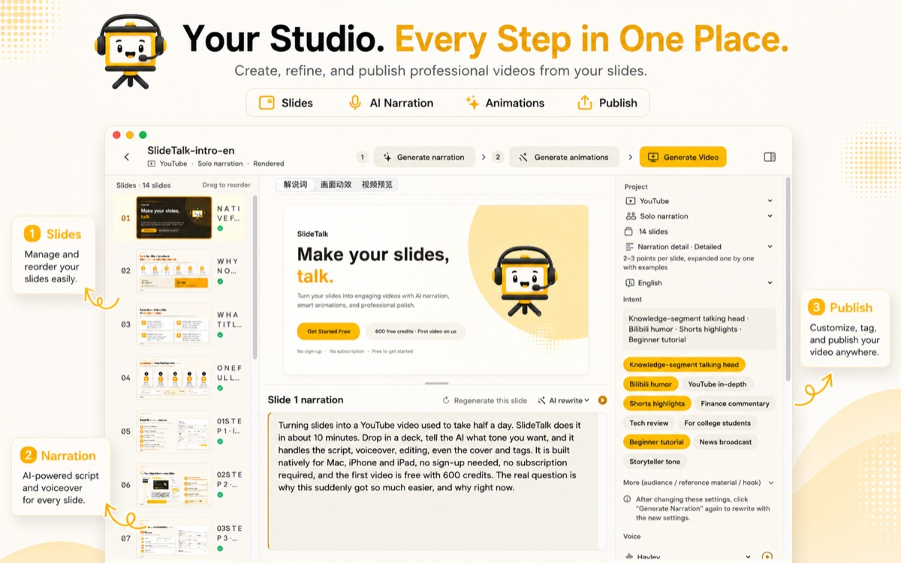
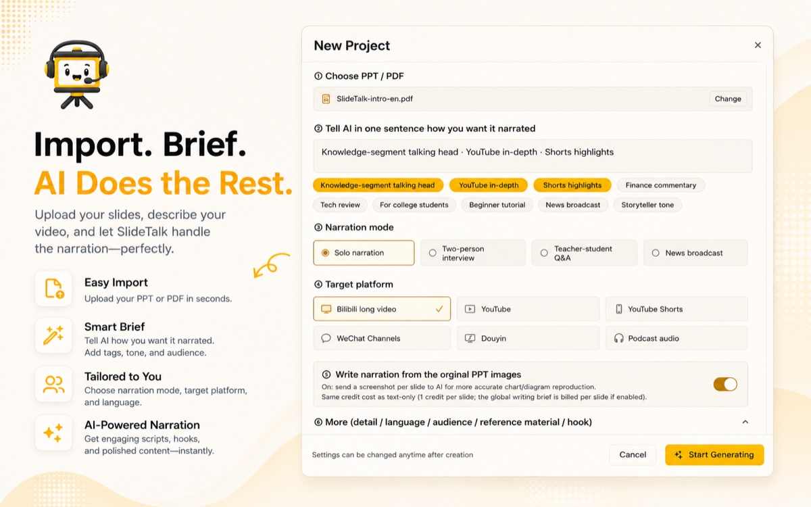
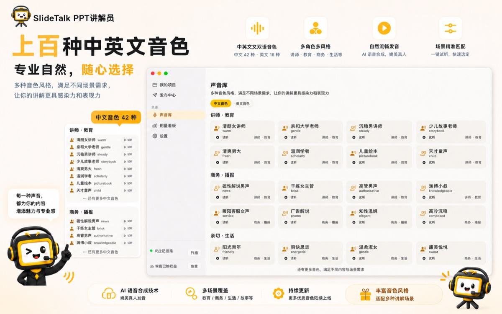
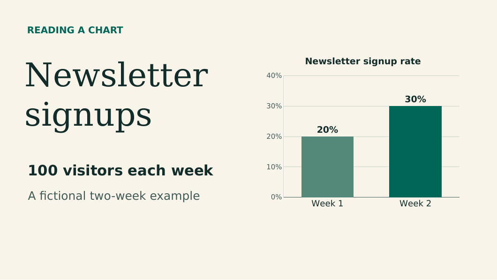

# SlideTalk · PPT to Video: turn a deck into a narrated video with AI voiceover, subtitles and a cover

**English** · [简体中文](README.zh-CN.md) · [繁體中文](guides/zh-TW/README.md) · [All 16 languages](guides/en/README.md)

  
  
  

  

Drop in a PowerPoint deck, say one sentence about who is watching, and SlideTalk writes the narration, voices it, adds subtitles and scene animations, renders the video — then drafts the cover, title, description, tags and chapters as well. **Ten minutes to a finished cut you can publish to YouTube, Bilibili or TikTok** — no camera, no microphone, no editing timeline.

This repository is the free companion kit: an editable sample deck, per-slide scripts, SRT files, storyboards, a pre-publish checklist, and illustrated tutorials in 16 languages. Everything is CC BY 4.0 — adapt it, reuse it commercially, just credit the kit.

- **Want the tool** → [SlideTalk on the App Store](https://apps.apple.com/us/app/slidetalk-ppt-to-video-ai/id6800015747) (Mac, iPhone, iPad; 600 free credits on sign-up)
- **Want templates** → grab the [sample deck and script](examples/chart-lesson/README.md), the [storyboard](templates/storyboard.csv) or the [export checklist](templates/export-checklist.md)
- **Want a method** → pick your role: [course video](use-cases/course-video.md) · [Bilibili knowledge channel](use-cases/bilibili-knowledge.md) · [financial report breakdown](use-cases/financial-report-video.md) · [corporate training](use-cases/corporate-training.md) · [vertical short video](use-cases/short-video.md)

## One video, one day saved

The expensive part of a knowledge video is not the idea. It is turning the idea into a cut. Here is the same 10-slide deck, five ways:

| Approach | Time for a 10-minute narrated video | On camera | Editing | Where it hurts |
| --- | --- | --- | --- | --- |
| Screen recording + your own voice + CapCut | 4–6 hours | Optional | Yes | One flubbed sentence means re-recording the segment |
| Script + audio recording + screen capture + manual captions | 6–8 hours | Yes | Yes | One video eats a weekend |
| Outsourced editing | 2–3 days | Yes | No | Communication overhead, one revision per day |
| **SlideTalk** | **10–20 min** (AI script + voiceover) + your review pass | **No** | **No** | Needs a Mac, iPhone or iPad |

These are order-of-magnitude figures reported by creators, not a promise; your slide count, voice choice and edit appetite all move the number. The real difference is in the workflow: the first three ask you to **perform** the video, SlideTalk asks you to **review** it.

## Three steps from deck to publishable video

  

1. **Import.** Drag in a `.pptx`, `.ppsx` or `.pdf`, or drop images (PNG, JPG, HEIC, WEBP). PDF renders page by page for the most faithful layout; PPTX rebuilds text, images, shapes and tables at their original coordinates.
2. **Say one sentence.** Something like "explain this data structures chapter to students preparing for a graduate exam" or "read this earnings deck in a dry, witty Bilibili voice". Then pick a narration mode, a target platform and a voice — the AI writes each slide's script against those constraints.
3. **Review, then render.** Edit slide by slide in the script studio (thumbnails left, script centre, properties right), generate the voiceover, animations and subtitles, render the cut, and let the Publish Center produce the cover, title, description, tags and chapters alongside it.

## You are not buying an mp4. You are buying the publish bundle.

  

Most tools stop at "export an mp4". But whether a video actually gets watched is decided in the half hour after export: is the thumbnail clickable, does the title carry the words people search for, does the description have chapters. The Publish Center does that part too:

| Asset | What is generated | What you can change |
| --- | --- | --- |
| Cover | Per-platform templates (Bilibili 3:2, YouTube 16:9, Shorts 9:16, WeChat Channels 3:4), high-contrast headline type and your brand palette | Swap template, rewrite copy, regenerate |
| Titles | A batch of candidates, each with CTR notes (length, keywords, curiosity, contrast phrasing) | Pick one, or write your own |
| Description / show notes | 200–500 words with keyword density, chapter timestamps and social hooks; a separate English description for YouTube | Copy and paste |
| Tags | 5–15 per platform: category and trends for Bilibili, SEO long-tail for YouTube, `#topic` format for TikTok | Add or remove |
| Chapters | Split by script semantics into `chapters.txt`, ready for Bilibili parts or YouTube chapters | Adjust the split points |
| Subtitles | Narration cut into CJK-safe short lines and burned in (5 style presets), plus a sidecar `.srt` | Change style or line breaks |

## Why the result is watchable

A slideshow with a voice on top loses the viewer in thirty seconds. SlideTalk adds the missing layer during rendering, entirely on your device with AVFoundation — nothing uploaded, nothing queued:

- **Six scene animations** — highlight, zoom, spotlight, arrow, underline, bracket. The frame emphasises whatever the narration is on, aligned to the script's character-level timeline.
- **AI picks the region, OCR snaps it** — the model reads what the slide is actually saying, then on-device Vision OCR snaps the box onto the real text lines so it never clips a character in half. Drag to fine-tune in the animation editor if you disagree.
- **Burned-in subtitles plus `.srt`** — five presets including the big short-video style, so Bilibili and WeChat Channels need no manual captioning; upload the `.srt` when YouTube's soft subtitles are what you want.
- **Ken Burns motion and cross-fades** — slow pans and zooms give static slides room to breathe. It stops looking like a screen-recorded slideshow.
- **Preview is the final cut** — the preview player and the exporter share one compositor, so what you see is what lands in the file.
- **480p to 4K, any length** — drop a split point on any page and one long deck exports as several videos, which is exactly what a series or a multi-part upload needs.

## 100+ AI voices, 4 narration modes

  

- Voices run on Volcengine Seed-TTS 2.0: **more than a hundred AI voices**, grouped into lecturer/education, business/broadcast, warm/lifestyle and trending/character. Speed from 0.5x to 2.0x, audition line by line, and auditioning costs no credits. Chinese and English are the deepest today, and the library keeps growing.
- **Four narration modes** — solo, two-person interview, teacher–student Q&A, and news anchor. Two-person modes assign a different voice to each role, which is what makes podcasts, weekly reviews and product teardowns feel like a conversation instead of a monologue.
- Scripts can be Chinese, English, or bilingual.

## Who uses it, and how

| You are | Your problem | What SlideTalk changes | Read this |
| --- | --- | --- | --- |
| Online course teacher / lecturer | A 30-lesson course takes two months to record, and changing one slide means re-recording | Decks ship as video; a script edit is not a re-record | [Course video and paid courses](use-cases/course-video.md) |
| Bilibili / YouTube knowledge creator | Three uploads a week is impossible, and being on camera is its own barrier | A steady schedule without showing your face or using your voice | [Bilibili knowledge channel](use-cases/bilibili-knowledge.md) |
| Analyst, researcher, finance creator | Research decks are wall-to-wall charts and reading them aloud sounds flat | Two-person mode plus chapters turns a deck into a 10-minute deep dive | [Financial report breakdown](use-cases/financial-report-video.md) |
| Corporate training, product, compliance | The same deck has to be delivered to hundreds of people, in several languages | One cut, many voices, rendered locally and never uploaded | [Corporate training](use-cases/corporate-training.md) |
| Xiaohongshu / TikTok creator | Turning posts into video means starting over | Posts become slides, slides become 9:16 video | [Vertical short video](use-cases/short-video.md) |

## Pricing: the download is free, you only pay for AI generation

| Item | How it is charged |
| --- | --- |
| Download, import, editing, voice audition, rendering, export | **Free forever** — 480p to 4K, no length limit, no cap on covers or titles |
| AI narration script | 1 credit per slide |
| AI voiceover | 1 credit per 10 characters |
| AI cover | 80 credits per image |
| AI title / description / tags | 2 credits per run |
| A 10-slide video, all in | ≈ 352 credits (about US$0.50) |
| Sign-up bonus | 600 credits (about 1.7 ten-slide videos) |
| Top-ups | US$0.99 / US$3.99 / US$9.99 / US$29.99 — first purchase doubles the credits and removes the watermark permanently; credits never expire |

No account to create and no API key to configure: the app uses Apple's AppTransaction to establish an anonymous identity and a credit wallet shared across every device on the same Apple ID. Each AI run quotes a price and freezes the credits first; if the balance runs out the job pauses and resumes from the same point after a top-up, so nothing is charged twice. **There is no subscription.**

> Prices are shown in your local currency by the App Store; the credit packs above are the US store tiers. Full rules are in the [FAQ](faq/README.md).

## How it compares with the alternatives

Screen recording, an online AI video site, an editor, an outsourcing studio — each is the right answer for a different problem, and we wrote the differences out on one page: [four approaches compared](compare/ppt-to-video-tools.md).

The short version: **screen recording captures, editing makes it pretty, SlideTalk means you never have to perform it.**

## Privacy and requirements

- Video is rendered **locally** by Apple AVFoundation — nothing uploaded, nothing queued. Project files, slide images, audio and finished cuts live in the app sandbox and are deleted with the app.
- Only AI generation needs a network: scripts send that slide's text (plus the slide image when visual understanding is on) through our gateway to the model provider, voiceover sends only the text to be read, and the gateway does not store your content.
- macOS 15.1+, iOS 17+, iPadOS 17+ — one universal app across Mac, iPhone and iPad. **No Windows build**; `.ppt`, `.pps` and Keynote `.key` files must be saved as `.pptx` or `.pdf` first.

## What is in this repository

| Folder | Contents |
| --- | --- |
| [examples/chart-lesson](examples/chart-lesson/README.md) | An editable four-slide deck with a matching PDF and preview, English and Chinese scripts, and two SRT files — a 40-second finished-cut example |
| [guides](guides/en/README.md) | Illustrated tutorials in 16 languages, each walking the full path from slides to script to voiceover to subtitles |
| [handbook](handbook/pptx-or-pdf.md) | Three specific problems solved: [PPTX or PDF](handbook/pptx-or-pdf.md), [speaker notes into a voiceover script](handbook/narration-and-speaker-notes.md), [caption collisions and drift](handbook/subtitles-and-export.md) |
| [templates](templates/storyboard.csv) | Storyboards in English and Chinese, [voiceover writing prompts](templates/voiceover-prompts.md), [pre-publish checklist](templates/export-checklist.md) |
| [use-cases](use-cases/README.md) | Role-based playbooks: courses, creators, finance, corporate training, short video |
| [compare](compare/ppt-to-video-tools.md) | An honest comparison of screen recording, editing, online tools and SlideTalk |
| [faq](faq/README.md) | 40 common questions: formats, watermarks, credits, languages, privacy, Windows |

### Try a 40-second lesson

Twenty of the first hundred visitors signed up for a newsletter, then thirty of the next hundred. Is that "up ten percentage points" or "up fifty percent"? Four slides, both statements true.

  

Open the [PowerPoint](examples/chart-lesson/example.pptx) or the [PDF](examples/chart-lesson/example.pdf), read the [English or Chinese script](examples/chart-lesson/narration.md) aloud, then check your timing against the [SRT files](examples/chart-lesson/en.srt). Every figure is fictional — change them freely.

## 16 languages, end to end

The app interface, the AI narration script, the subtitle renderer and this kit all work in 16 languages. Here is the full list, with the code each one uses and the tutorial that walks through it:

| Language | Native name | Code | Tutorial |
| --- | --- | --- | --- |
| English | English | `en` | [Convert a deck to MP4 with narration](guides/en/README.md) |
| Chinese (Simplified) | 简体中文 | `zh-CN` | [一页图表做成微课](guides/zh-CN/README.md) |
| Chinese (Traditional) | 繁體中文 | `zh-TW` | [繁體中文教學](guides/zh-TW/README.md) |
| Arabic | العربية | `ar` | [دليل عربي](guides/ar/README.md) |
| German | Deutsch | `de` | [Deutsche Anleitung](guides/de/README.md) |
| Spanish | Español | `es` | [Guía en español](guides/es/README.md) |
| French | Français | `fr` | [Guide en français](guides/fr/README.md) |
| Hindi | हिन्दी | `hi` | [हिन्दी गाइड](guides/hi/README.md) |
| Italian | Italiano | `it` | [Guida in italiano](guides/it/README.md) |
| Japanese | 日本語 | `ja` | [日本語ガイド](guides/ja/README.md) |
| Korean | 한국어 | `ko` | [한국어 가이드](guides/ko/README.md) |
| Norwegian Bokmål | Norsk bokmål | `nb` | [Norsk veiledning](guides/nb/README.md) |
| Dutch | Nederlands | `nl` | [Nederlandse handleiding](guides/nl/README.md) |
| Portuguese | Português | `pt` | [Guia em português](guides/pt/README.md) |
| Russian | Русский | `ru` | [Руководство на русском](guides/ru/README.md) |
| Swedish | Svenska | `sv` | [Svensk guide](guides/sv/README.md) |

What "supported" actually covers, language by language:

| Surface | Coverage |
| --- | --- |
| App interface | All 16 languages above |
| AI narration script | Written in whichever language you brief it in; Chinese, English and bilingual decks are first-class |
| AI voiceover | 100+ voices, deepest in Chinese and English, with the library still growing |
| Subtitles | Burned-in captions break lines safely for Chinese, Japanese and Korean; the sidecar `.srt` works in any language |
| This repository | Guides, storyboards and checklists in all 16 languages |

Each guide uses different source material on purpose — the French one walks through a form submission, the Arabic one narrates a map, the Chinese ones explain a chart and train a library volunteer — so none of them reads like the same text run through a translator.

## FAQ highlights

**How is SlideTalk different from an ordinary PPT-to-video tool?**
Ordinary tools stop when the slides and a voice have been stitched into an mp4. SlideTalk does two more things: it makes the video sound like a person is teaching (per-slide AI script, voiceover, subtitles, scene animations, camera motion), and it makes the video publishable (cover, title, description, tags and chapters generated together). It also runs on an anonymous Apple account — no sign-up, no API keys — and renders on your own machine.

**Does the exported video have a watermark?**
Yes until you top up; any first purchase removes it permanently.

**Does it run on Windows?**
No. Mac, iPhone and iPad are one universal app, requiring macOS 15.1+, iOS 17+ or iPadOS 17+.

**What does AI generation cost for a 10-minute video?**
About 352 credits, roughly US$0.50, covering the script and the voiceover. The 600 welcome credits are enough for about 1.7 videos.

**Is my deck uploaded to a server?**
No. Projects and finished cuts stay in the local sandbox and rendering happens on-device. Only the AI steps send data out — that slide's text (plus its image when visual understanding is on) for scripts, and the text to be read for voiceover — and the gateway does not store it.

More in the [full FAQ](faq/README.md).

## License

The guides, sample deck, scripts, subtitles and worksheets in this repository are licensed under [CC BY 4.0](LICENSE.md): adapt and reuse them commercially, just credit the SlideTalk Creator Kit and note your changes. The SlideTalk app itself is distributed separately through the App Store. Typos, translation improvements and your own case studies are welcome as issues or pull requests.

  <a href="https://apps.apple.com/us/app/slidetalk-ppt-to-video-ai/id6800015747"><b>→ Download SlideTalk and make your first video</b></a> 
  Free download · 600 credits on sign-up · editing, rendering and export are free forever

