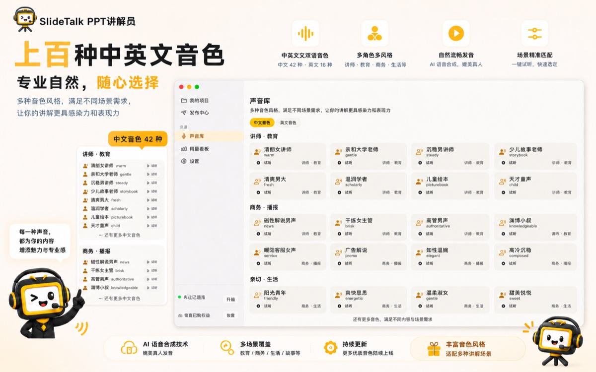
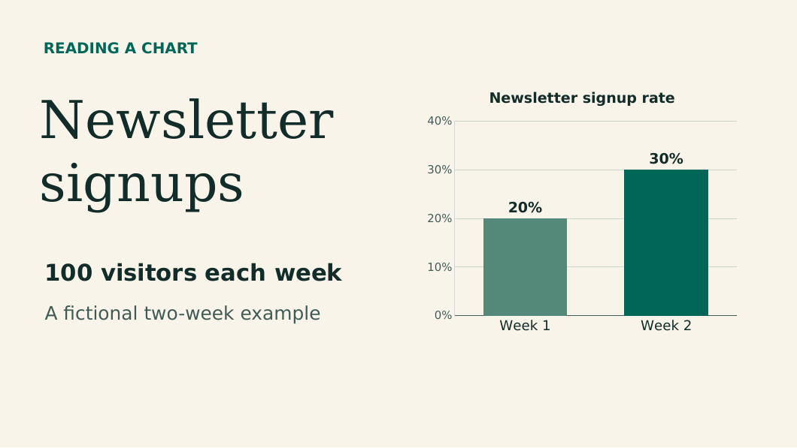

# SlideTalk · PPT 转视频：把幻灯片变成带 AI 配音、字幕和封面的成品视频

**简体中文** · [English](README.md) · [繁體中文](guides/zh-TW/README.md) · [全部 16 种语言](guides/zh-CN/README.md)

  
  
  

  

拖入一份 PPT，说一句「这期讲给谁听」，AI 写稿、配音、加字幕和场景动效，渲染成片，再顺手把封面、标题、简介、标签、章节一起做出来。**10 分钟拿到一条能直接发到 B 站、YouTube、视频号、抖音的成品视频**——不用出镜、不用开口、不用学剪辑。

这是一个为「有 PPT、想做成视频」的人准备的**免费素材仓库**：可编辑的示例 PPT、逐句讲稿、SRT 字幕、分镜表、发布检查清单，以及 16 种语言的图文教程。素材全部 CC BY 4.0，可以随便改、随便商用。

- **要工具** → [App Store 下载 SlideTalk](https://apps.apple.com/app/id6800015747)（Mac / iPhone / iPad，注册送 600 积分）
- **要模板** → 直接拿 [示例 PPT 与讲稿](examples/chart-lesson/README.md)、[分镜表](templates/storyboard.csv)、[发布检查清单](templates/export-checklist.md)
- **要方法** → 按你的身份看：[课程录制](use-cases/course-video.zh-CN.md) · [B 站知识区日更](use-cases/bilibili-knowledge.zh-CN.md) · [财报解读](use-cases/financial-report-video.zh-CN.md) · [企业培训](use-cases/corporate-training.zh-CN.md) · [竖屏短视频](use-cases/short-video.zh-CN.md)

> In English: SlideTalk turns a PowerPoint deck or PDF into a narrated MP4 with AI voiceover, burned-in subtitles, scene animations, and a publish-ready cover, title, description, tags and chapters — natively on Mac, iPhone and iPad. This repository is the free companion kit: sample deck, scripts, SRT files, storyboards and tutorials in 16 languages. [Read the English guide](guides/en/README.md) · [App Store](https://apps.apple.com/app/id6800015747)

## 一条视频，省下一整天

做知识类视频最贵的不是想法，是把想法变成片子。同一份 10 页课件，做法的差距是这样的：

| 做法 | 一条 10 分钟讲解视频的耗时 | 要出镜 | 要剪辑 | 主要痛点 |
| --- | --- | --- | --- | --- |
| 录屏 + 自己念 + 剪映 | 4–6 小时 | 可选 | 是 | 口误要重录，字幕要手动对轴 |
| 写稿 + 录音 + 录屏 + 上字幕 | 6–8 小时 | 是 | 是 | 一条视频吃掉一个周末 |
| 外包剪辑 | 2–3 天 | 是 | 否 | 沟通成本高，改一版等一天 |
| **SlideTalk** | **10–20 分钟**（AI 写稿配音）+ 人工微调 | **否** | **否** | 需要一台 Mac / iPhone / iPad |

耗时是常见创作者反馈的量级参考，不是承诺值；实际取决于页数、音色选择和你的修改量。真正的差别在流程：上面三种做法都要你「演一遍」，SlideTalk 让你「审一遍」。

## 三步，从 PPT 到可发布视频

  

1. **导入**：把 `.pptx` / `.ppsx` / `.pdf` 拖进 App，或者直接拖图片（PNG / JPG / HEIC / WEBP）。PDF 逐页渲染，版式还原最准；PPTX 保留文字、图片、形状、表格的原始位置。
2. **说一句话**：比如「面向考研学生讲这章数据结构」「按 B 站幽默口播风格讲这份财报」。再选讲解模式、目标平台和音色——AI 会按这些条件逐页写讲解词。
3. **审一遍，出片**：在脚本工作台里逐页改稿（左缩略图 / 中脚本 / 右属性），一键生成配音、动效、字幕，渲染成片，发布中心同步产出封面、标题、简介、标签、章节。

## 你拿到的不是一个 mp4，是一整套发布物料

  

大多数工具止步于「导出一个 mp4」。而一条视频能不能涨粉，往往取决于导出之后那半小时：封面够不够抓眼、标题有没有关键词、简介有没有章节。SlideTalk 的发布中心把这些一起做掉：

| 物料 | 自动生成的内容 | 你可以怎么改 |
| --- | --- | --- |
| 封面 | 按平台模板出图（B 站 3:2 / YouTube 16:9 / Shorts 9:16 / 视频号 3:4），高对比大字标题 + 品牌色 | 换模板、改文案、重新生成 |
| 标题 | 一批候选，每个附 CTR 优化说明（字数、关键词、好奇心、对比句式） | 挑一个，或自己改 |
| 简介 / Show Notes | 200–500 字，含关键词密度、章节时间点、社交引流；YouTube 可另出英文简介 | 直接复制粘贴 |
| 标签 | 每平台 5–15 个：B 站结合分区与热点，YouTube 走 SEO 长尾，抖音 / 视频号出 `#` 话题格式 | 增删 |
| 章节 | 按脚本语义切分，生成 `chapters.txt`，直接填进 B 站分 P 或 YouTube 章节 | 调整切点 |
| 字幕 | 按讲稿切成 CJK 安全短句烧进画面（5 款样式）+ 旁挂 `.srt` | 改样式、改断句 |

## 为什么成片「能看下去」

静态翻页配旁白，观众三十秒就划走。SlideTalk 在渲染阶段自动补上这些，全部在你的设备上用 AVFoundation 完成，不上传、不排队：

- **6 种场景动效**：高亮、放大、聚光、箭头、下划线、括号。讲到哪里画面强调哪里，跟讲稿的字符时间轴对齐。
- **AI 挑重点 + OCR 贴合**：AI 读懂这页在讲什么，挑出该强调的区域，再用端上 Vision OCR 精确贴到真实文字行，不会框歪半个字。不满意可以在动效编辑器里拖拽微调。
- **字幕硬压 + `.srt`**：5 款样式预设（含短视频大字幕风格），B 站、视频号免手动上字幕；YouTube 想用软字幕就上传那份 `.srt`。
- **Ken Burns 运镜 + 页间渐变**：静态幻灯片也有呼吸感，不再是「幻灯片录屏」。
- **预览即成片**：预览播放器和导出器共用同一套 compositor，你看到的就是导出的样子。
- **480p–4K、时长不限**：长片可以在任意页打分段点，拆成多支视频分别导出，适合系列课和分 P 投稿。

## 上百款音色，4 种讲解模式

  

- 音色基于火山 Seed-TTS 2.0，**上百款**，分「讲师·教育」「商务·播报」「亲切·生活」「爆款·特色」四类；0.5x–2.0x 语速，可逐句试听，试听不消耗积分。目前中文和英文音色最全，音色库还在持续扩充。
- **4 种讲解模式**：单人讲解、双人访谈、师生问答、新闻播报。双人模式自动给两个角色分配不同音色，适合播客、周报解读、产品评测这类有对话感的视频。
- 讲稿语言支持中文、英文、中英双语。

## 谁在用，怎么用

| 你是 | 你的痛点 | SlideTalk 怎么解 | 具体做法 |
| --- | --- | --- | --- |
| 网课老师 / 课程讲师 | 一门课 30 个课时，录一遍要两个月，改一页就得重录 | 课件直接出片，改稿不用重录 | [课程录制与知识付费](use-cases/course-video.zh-CN.md) |
| B 站 / YouTube 知识区 UP 主 | 一周三更做不到，出镜又有心理门槛 | 不露脸、不开口也能稳定日更 | [B 站知识区日更](use-cases/bilibili-knowledge.zh-CN.md) |
| 财经 / 行业分析师、研究员 | 研报和财报 PPT 全是图表，自己讲不专业 | 双人访谈模式 + 章节，做成 10 分钟深度片 | [财报与研报解读](use-cases/financial-report-video.zh-CN.md) |
| 企业培训 / 产品 / 安全合规 | 同一套课件要给几百人讲，还要多语言 | 一次成片，多语言音色，本机渲染不外传 | [企业培训与产品演示](use-cases/corporate-training.zh-CN.md) |
| 小红书 / 抖音图文创作者 | 图文转视频要重做一遍 | 图文转成 PPT，直接出 9:16 竖屏 | [竖屏短视频](use-cases/short-video.zh-CN.md) |

## 定价：下载免费，只给 AI 生成付费

| 项目 | 计费方式 |
| --- | --- |
| 下载、导入、编辑、试听音色、渲染、导出 | **永久免费**，480p–4K、时长不限、封面与标题数量不限 |
| AI 写讲解词 | 1 积分 / 页 |
| AI 配音 | 1 积分 / 10 字 |
| AI 封面 | 80 积分 / 张 |
| AI 标题 / 简介 / 标签 | 2 积分 / 次 |
| 一条 10 页视频合计 | ≈ 352 积分（约 ¥3.5） |
| 注册赠送 | 600 积分（约 1.7 条 10 页视频） |
| 充值 | ¥6 / ¥28 / ¥68 / ¥198 四档，首充积分翻倍、永久去除导出水印，积分永不过期 |

不需要注册账号，不需要配置任何 API Key：App 用 Apple 的 AppTransaction 建立匿名身份和积分钱包，同一 Apple ID 的设备共享余额。每次 AI 生成前先报价再冻结，余额不足自动暂停，充值后从断点继续，不重复扣费。**不做订阅。**

> App Store 按你所在地区的货币显示价格；上表的人民币档位是中国大陆区价格。完整规则见 [常见问题](faq/README.zh-CN.md)。

## 和其他做法比，差在哪

录屏软件、在线 AI 转视频网站、剪辑软件、外包——四种做法各有适用场景，我们把差异摊开写在一页里：[四种做法对比](compare/ppt-to-video-tools.zh-CN.md)。

一句话总结：**录屏解决「记录」，剪辑解决「好看」，SlideTalk 解决「不用你亲自演」。**

## 隐私与要求

- 视频由 Apple AVFoundation **在本机渲染**，不上传、不排队；项目文件、幻灯片图、音频、成片都存在 App 沙盒里，卸载即删。
- 需要联网的只有 AI 生成环节：讲稿把对应页面的文本（开启视觉理解时含该页图像）经自家网关转发给模型服务商，配音只发要朗读的文本，网关不存储用户内容。
- 支持 macOS 15.1+ / iOS 17+ / iPadOS 17+，同一个通用 App 覆盖 Mac、iPhone、iPad。**暂不支持 Windows**；`.ppt` / `.pps` / Keynote `.key` 请先另存为 `.pptx` 或 `.pdf`。

## 这个仓库里有什么

| 目录 | 内容 |
| --- | --- |
| [examples/chart-lesson](examples/chart-lesson/README.md) | 一份可直接改的 4 页示例 PPT（附 PDF、预览图）、中英文讲稿、中英文 SRT，40 秒成片范例 |
| [guides](guides/en/README.md) | 16 种语言的图文教程，每篇走完「幻灯片 → 讲稿 → 配音 → 字幕」一条完整链路 |
| [handbook](handbook/pptx-or-pdf.md) | 三个具体问题的解法：[PPTX 还是 PDF](handbook/pptx-or-pdf.md)、[演讲备注怎么变口播稿](handbook/narration-and-speaker-notes.md)、[字幕遮挡与对轴排错](handbook/subtitles-and-export.md) |
| [templates](templates/storyboard.csv) | 分镜表（中英双版）、[口播稿写作提示词](templates/voiceover-prompts.md)、[发布前检查清单](templates/export-checklist.md) |
| [use-cases](use-cases/README.zh-CN.md) | 按身份写的落地方案：课程、UP 主、财报、企业培训、短视频 |
| [compare](compare/ppt-to-video-tools.zh-CN.md) | 录屏 / 剪辑 / 在线工具 / SlideTalk 的诚实对比 |
| [faq](faq/README.zh-CN.md) | 40 个高频问题：格式、水印、积分、多语言、隐私、Windows |

### 试一条 40 秒的样片

20% 到 30%，是「涨了十个百分点」还是「涨了 50%」？用四页幻灯片把两种说法都讲清楚：

  

打开 [示例 PPT](examples/chart-lesson/example.pptx) 或 [PDF](examples/chart-lesson/example.pdf)，照着 [中英文讲稿](examples/chart-lesson/narration.md) 念一遍，再用 [中英文 SRT](examples/chart-lesson/en.srt) 对轴。数字全部虚构，可以随便改。

## 16 种语言，从界面到字幕

App 界面、AI 讲稿、字幕渲染和这套教程都覆盖 16 种语言。下面把语言、对应代码和教程一次列全：

| 语言 | 本地名称 | 代码 | 教程 |
| --- | --- | --- | --- |
| 英语 | English | `en` | [把 PPT 转成带配音的 MP4](guides/en/README.md) |
| 简体中文 | 简体中文 | `zh-CN` | [一页图表做成微课](guides/zh-CN/README.md) |
| 繁体中文 | 繁體中文 | `zh-TW` | [繁體中文教學](guides/zh-TW/README.md) |
| 阿拉伯语 | العربية | `ar` | [دليل عربي](guides/ar/README.md) |
| 德语 | Deutsch | `de` | [Deutsche Anleitung](guides/de/README.md) |
| 西班牙语 | Español | `es` | [Guía en español](guides/es/README.md) |
| 法语 | Français | `fr` | [Guide en français](guides/fr/README.md) |
| 印地语 | हिन्दी | `hi` | [हिन्दी गाइड](guides/hi/README.md) |
| 意大利语 | Italiano | `it` | [Guida in italiano](guides/it/README.md) |
| 日语 | 日本語 | `ja` | [日本語ガイド](guides/ja/README.md) |
| 韩语 | 한국어 | `ko` | [한국어 가이드](guides/ko/README.md) |
| 挪威语（书面） | Norsk bokmål | `nb` | [Norsk veiledning](guides/nb/README.md) |
| 荷兰语 | Nederlands | `nl` | [Nederlandse handleiding](guides/nl/README.md) |
| 葡萄牙语 | Português | `pt` | [Guia em português](guides/pt/README.md) |
| 俄语 | Русский | `ru` | [Руководство на русском](guides/ru/README.md) |
| 瑞典语 | Svenska | `sv` | [Svensk guide](guides/sv/README.md) |

「支持」具体支持到哪一步：

| 范围 | 覆盖情况 |
| --- | --- |
| App 界面 | 上表 16 种语言全覆盖 |
| AI 讲稿 | 你用哪种语言描述需求就写哪种；中文、英文、中英双语支持最完整 |
| AI 配音 | 上百款音色，中文和英文最全，音色库还在扩充 |
| 字幕 | 硬压字幕对中、日、韩做安全断句；旁挂 `.srt` 支持任意语言 |
| 本仓库 | 教程、分镜表、检查清单覆盖 16 种语言 |

每篇教程刻意用不同素材：法语篇讲表单提交，阿拉伯语篇讲地图，中文篇讲图表和图书馆志愿者培训——避免读起来像同一篇机翻。

## 常见问题（精选）

**SlideTalk 和普通「PPT 转视频」工具有什么区别？**
普通工具把幻灯片拼成 mp4 就结束了。SlideTalk 多走两步：一是让视频「像有人在讲」——逐页 AI 讲稿、配音、字幕、场景动效、运镜；二是让视频「能发出去」——封面、标题、简介、标签、章节一起生成。另外它用匿名 Apple 账号直接开用，不注册、不配 API Key，渲染在本机完成。

**生成的视频有水印吗？**
未充值导出带品牌水印；任意金额首充后永久去除。

**支持 Windows 吗？**
暂不支持。Mac、iPhone、iPad 三端是同一个通用 App，需要 macOS 15.1+ / iOS 17+ / iPadOS 17+。

**一条 10 分钟视频要花多少 AI 费用？**
约 352 积分，折合人民币约 3.5 元，含 AI 写稿和配音；新人赠送的 600 积分够做约 1.7 条。

**我的 PPT 会上传到服务器吗？**
不会。项目和成片都在本机沙盒里，渲染由 AVFoundation 本地完成；只有 AI 生成环节会把对应页面的文本（开启视觉理解时含该页图像）经网关转给模型服务商，网关不存储内容。

更多问题见 [完整 FAQ](faq/README.zh-CN.md)。

## 素材授权

本仓库的教程、示例 PPT、讲稿、字幕和表格以 [CC BY 4.0](LICENSE.md) 授权，可自由改编与商用，注明来源即可。SlideTalk App 本身通过 App Store 单独分发。发现错别字、想补一篇翻译、或想加一个你自己的案例，欢迎提 issue 或 PR。

  <a href="https://apps.apple.com/app/id6800015747"><b>→ 下载 SlideTalk，做你的第一条视频</b></a> 
  免费下载 · 注册送 600 积分 · 编辑 / 渲染 / 导出永久免费

