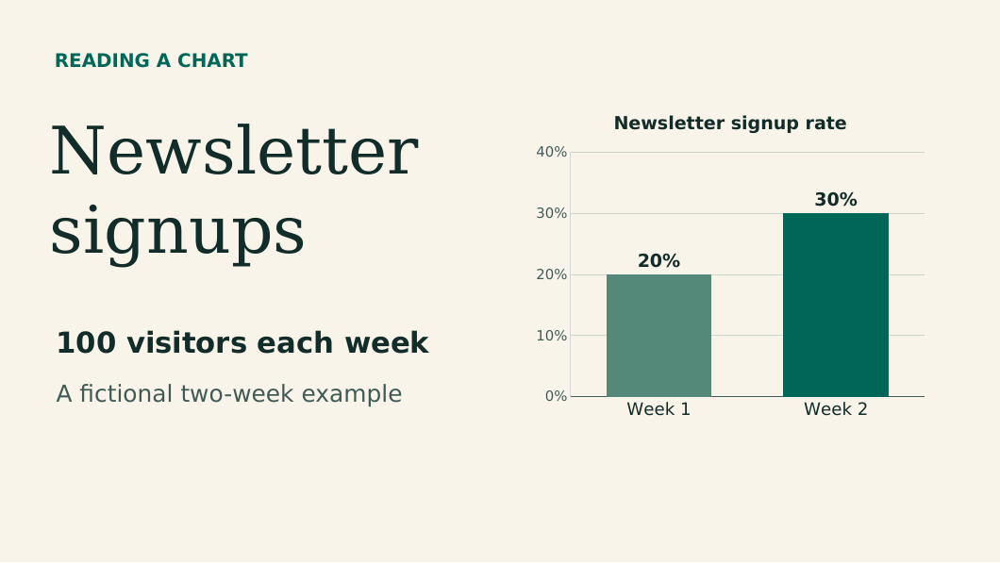

# A 40-second narrated chart lesson

A newsletter received 100 visitors in each of two weeks. Signups rose from 20 to 30. How would you say that change aloud? This four-slide exercise shows how to turn a chart into a short explainer and check that the voice and captions preserve the units. The numbers are fictional.

## Practice files

| File | How to use it |
| --- | --- |
| [Four editable PowerPoint slides](example.pptx) | Change the labels, chart values and text in PowerPoint. Each slide has English speaker notes. |
| [Four-page PDF](example.pdf) | Preview the visuals or import this copy into SlideTalk to preserve the native chart's appearance. |
| [English and Mandarin narration](narration.md) | Copy the text for one language, one slide at a time. The on-screen slide text is English in both cases. |
| [English subtitles](en.srt) · [Simplified Chinese subtitles](zh-CN.srt) | Use these as examples when reviewing line breaks and caption timing. Each file has eight cues. |

## Make the video

1. Download the PDF and import it into SlideTalk. Check that the first page shows both bars and that the values above them read **20%** and **30%**. To change the underlying figures, edit the PPTX in PowerPoint and export a new PDF.
2. Choose one narrator. Read through the matching script and place each paragraph with its slide. For an alternative AI draft, try the prompt below and compare the result with the reference script.
3. Preview slides two and three with audio. On slide two, listen for **ten percentage points**. On slide three, listen for **fifty percent** and an explicit comparison with week one.
4. Render the video and watch it once with the sound off. The lower caption area should leave the bar labels and both formulas visible. The sample SRT files assume exactly ten seconds per slide. Retime the cues to the actual voice and slide changes before publishing.

> Explain this chart to a new newsletter editor in four short scenes. Say how many visitors came each week, then give the two signup rates. Explain the gap in percentage points. Use the first week as the starting point for relative growth. Finish with one sentence the editor could read aloud. Keep the numbers and units exactly as shown.

## Check your take

| Time target | What the viewer should understand |
| --- | --- |
| 00:00–00:10 | 20 of 100 visitors signed up in week one. In week two, 30 of 100 signed up. |
| 00:10–00:20 | Subtracting the rates gives **10 percentage points**. |
| 00:20–00:30 | Dividing the change by the starting rate gives **(0.30 − 0.20) ÷ 0.20 = 0.50**, or **50%** relative growth. |
| 00:30–00:40 | A listener hears both endpoints and understands what “higher” refers to. |

**Try changing the example.** Keep 100 visitors per week and change the signup counts to 40 and 50. The gap is still 10 percentage points. Relative growth is now 25% because the starting rate doubled. Update the chart, formulas, speaker notes and captions together.

[Back to the SlideTalk toolkit](../../README.md)
